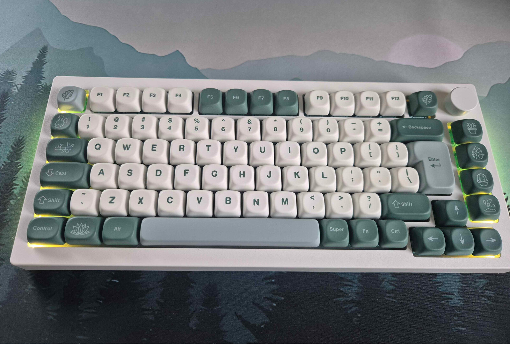

# RMK firmware for the Akko 5075B Plus



Rust firmware ([RMK](https://github.com/HaoboGu/rmk) on [Embassy](https://embassy.dev)) for the
Akko 5075B Plus, a 75% wireless keyboard on a WestberryTech WB32FQ95 (Cortex-M3, 96 MHz). It
does everything the vendor's QMK build does:
- USB, Bluetooth 1-3 and the 2.4G dongle;
- Vial (the vendor ships VIA), over USB and through the 2.4G dongle;
- the RGB matrix and side lights;
- the knob;
- battery reporting;
- sleep and stop mode.

It also reacts faster, keeps the CPU asleep between events, and fixes the vendor's wireless bugs.

There was no Rust support for the WB32, so this repo also carries a PAC and a HAL for the chip.

## Compared with the vendor's QMK

The comparison is with the vendor's firmware as shipped: the vendor's QMK source, built with
symbols, which we checked function by function against the stock image. Our own fixes to that QMK
build aren't published, so they don't count here. Both images ran in the same simulation, and
`m7_power` and `qmk_power` take the numbers (in `sim-rs`, and in Renode's `sim`).

| | Vendor QMK | This firmware |
|---|---|---|
| Key press to report ready | 5 ms or more | 0.7 ms |
| Key release to report ready | 5 ms or more | 5.0 ms on average |
| CPU awake, idle, lights on | 100% | 10.6% |
| CPU awake, idle, lights off | 100% | 0.4% |
| CPU awake, a key held | 100% | 54% |
| CPU awake, host asleep | not measured | 0.1% |
| Wake-ups per second, idle, lights off | never sleeps (SysTick 100,000/s) | about 75 |
| Wake-ups per second, idle, lights on | never sleeps | about 29,000 (the LED feed's interrupts) |
| Est. MCU current, idle, lights on | 13.5 mA | 1.5 to 13.5 mA |
| Est. MCU current, idle, lights off | 13.5 mA | 0.14 to 13.5 mA |
| Est. MCU current, a key held | 13.5 mA | 7.4 to 13.5 mA |
| Est. MCU current, host asleep, stop mode on | not measured | 0.035 mA |

- **Latency.** The vendor build uses QMK's default debounce, `sym_defer_g` at 5 ms: a change is
  reported only after the whole matrix has been quiet for 5 ms. Here a press goes out at once, and
  only the release waits out its 5 ms. The scan parks on the rows' interrupts when no key is down,
  so a press wakes it. The host's 1 ms USB polling comes on top for both. QMK's latency is taken
  from its source: in the simulation, its reports go to the radio module.
- **CPU time.** QMK's main loop polls the matrix without pause, and its CPU never sleeps. Here
  every task waits for an interrupt or a deadline: the scan parks, SysTick is tickless, and the
  knob, radio and power tasks don't poll. "CPU awake" is the simulator's core clocks awake per
  emulated second, against 96 MHz. Each instruction takes its cycles from the Cortex-M3 manual's
  table, with no flash wait states, which matches a delay loop timed on the board.
- **Current.** The simulator's estimate of the MCU's share only (`sim-rs` `wb32-sim` `power.rs`),
  from the [WB32FQ95xC datasheet](https://www.westberrytech.com/uploads/file/WB32FQ95xx/EN_DS1905020_WB32FQ95xC_V01.pdf)
  at 3.3 V: ~140 µA/MHz of HCLK while awake (13.4 mA at 96 MHz), ~35 µA stopped, and the
  internal oscillators' 25 and 55 µA, which both firmwares leave on. The datasheet gives no
  figure for sleep mode, where only the CPU's clock stops and the bus, flash and peripherals run
  on at 96 MHz. So this firmware's numbers are a range: from sleep costing nothing to sleep costing
  as much as running. Where in that range the chip is decides the idle current, so measure it on
  the board before quoting battery life. Stop mode stops every clock and avoids the question:
  by default once the host is gone (the link lost for 30 s, as with the computer off), not while
  it's only suspended, whose wake-up frame a stop would lose; `tools/sleep.py stop on` stops
  whenever asleep. The LEDs, the radio module and the HSE crystal and PLL (no
  datasheet figures) aren't counted.
- **Wireless.** The link to the BT/2.4G module (`crates/qmk-wireless`) fixes the vendor's bugs, and
  its tests check it against QMK's C (`tools/wls_host_test`). The UART parser resyncs after a bad
  frame and checks bounds, the retry limit works, re-pairing the dongle can't overflow the send
  buffer, and a key release is never dropped while the link is down.
- **Recovery.** A watchdog and a panic handler restart a hung or crashed keyboard. A second crash
  within 60 s goes to the ROM bootloader, and Vial can read the panic message. The vendor build
  has no watchdog.
- **Battery over USB.** The host sees the battery level (Linux shows it in upower); the vendor build doesn't report it over USB.

## What's here

| Path | Crate | What it is | Reusable? |
|---|---|---|---|
| `crates/wb32-pac` | `wb32-pac` | Register access for the WB32FQ95, generated from the vendor header | Any WB32FQ95 project |
| `crates/wb32-hal` | `wb32-hal` | Embassy drivers for the WB32FQ95 | Any WB32FQ95 project, with the limits in its README |
| `crates/qmk-wireless` | `qmk-wireless` | Sans-I/O protocol for the BT/2.4G module in QMK's `keyboards/linker/wireless` boards | Keyboards with that module |
| `crates/akko-boot-guard` | `akko-boot-guard` | Reset-time escape into ROM DFU, crash record and crash policy | This board |
| `crates/akko-lighting` | `akko-lighting` | QMK rgb_matrix port plus this board's lights and indicators | This board (the rgb_matrix part is generic in nature, but tied to this layout) |
| `firmware` | `firmware` | The `akko-rmk` image and the bring-up images `m1a-bounce`, `m1b-stub`, `m2-blink`, `m3-usb` | This board |
| `third_party/rmk` | `rmk` | Submodule: [our fork](https://github.com/rmsthebest/rmk), branch `akko-main`: RMK main with our hooks and fixes (`rmk/README-akko.md`) | |
| `third_party/musb` | `musb` | Submodule: [our fork](https://github.com/rmsthebest/musb), branch `wb32`: musb 0.3.1 with WB32 support and fixes (`README-wb32.md`) | |
| `sim-rs/` | | Our own simulator of the board (a Cortex-M3 interpreter and the WB32FQ95's peripherals in Rust) and the test suites, under `cargo test`: the gate for every image (`sim-rs/README.md`) | |
| `sim/` | | The Renode simulation the suites were first written for, kept as a cross-check, and the QMK reference runs (`sim/README.md`) | |
| `rom/` | | The chip's ROM bootloader, studied: read-out (`rom-peek` feature), disassembly tools, the ROM in Renode, write-up (`rom/README.md`). The ROM itself isn't in the repo | |
| `tools/` | | Generators (PAC, keymap, LED layout, Vial JSON), checks (precheck, rgbref, PAC vs manual), the workbench | |

Naming: a chip or protocol name means the crate is meant to be reusable. An `akko-` prefix means it's
written for this board.

## Build, test, flash

```fish
git submodule update --init              # third_party/rmk and third_party/musb
cargo build --release --bin akko-rmk     # target thumbv7m-none-eabi (needs flip-link; rust-toolchain.toml pins a nightly)
sim-rs/run.sh                            # build the images, run every sim test (about 2 min): the gate
sim/run.sh                               # the same suites in Renode, a cross-check (about 25 min)
cargo test -p qmk-wireless --target x86_64-unknown-linux-gnu
tools/wls_host_test/run.sh               # QMK's wireless C on the host (QMK_TREE), against the same test data
cargo test -p akko-lighting --target x86_64-unknown-linux-gnu
python3 -I tools/rgbref/run.py           # akko-lighting against QMK's C, frame by frame
python3 -I tools/bench.py                # workbench on :8475: sim runs, freeze, flash RMK or QMK
```

[`FLASHING.md`](FLASHING.md) has the whole flashing procedure. It covers the bootloader, the checks after a flash,
Vial (vial.rocks also works through the 2.4G dongle, while desktop Vial needs USB) and going back to QMK.

## Flashing safety

The case can't be opened: there's no SWD and no BOOT0. The ROM DFU bootloader can only be reached
through code in the running image. That's either the RAM magic word, which QMK and RMK both honour,
or Esc held at a cold start.

So, before an image goes to the board:
- every image must link `akko-boot-guard`;
- `tools/precheck.py` must pass on it;
- it must be frozen and tested in the sim first.

The workbench refuses to flash anything else.

## License

GPL-2.0-or-later (`LICENSE`). Much of this code is a port of QMK and of the vendor's QMK keyboard
code. `third_party/` keeps its upstream licenses: rmk is MIT OR Apache-2.0, musb is Apache-2.0. `rom/rust/` (the ROM bootloader rewritten in Rust) is MIT OR Apache-2.0.
